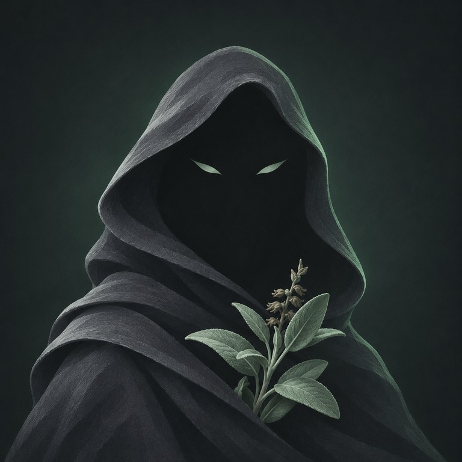

  

<h1 align="center">Шалфей Предсказатель</h1>

Shalfey Predskazatel

<strong>Красивые и бесплатные программы</strong> Beautiful, useful and free desktop software

Создаю и публикую программы для Windows: удобные инструменты с понятным интерфейсом. Здесь можно скачать готовые сборки, посмотреть исходники и сообщить о проблемах.

I build and share free Windows apps with thoughtful interfaces. Explore the source, download a release, or report an issue in the project repository.

## Kinetrell

Портативный плеер для Windows с генерацией кадров VFG и RIFE, RTX Video Super Resolution и HDR. Доступны три редакции — **VFG**, **RIFE** и **Duo**. Maxine входит в VFG и Duo.

A portable Windows video player with NVIDIA VFG, RIFE, RTX Video Super Resolution and HDR.

**[Скачать / Download](https://github.com/Yamidashka/rtx-video-player/releases/latest)** · [Исходники / Source](https://github.com/Yamidashka/rtx-video-player) · [Сообщить о проблеме / Report an issue](https://github.com/Yamidashka/rtx-video-player/issues)
