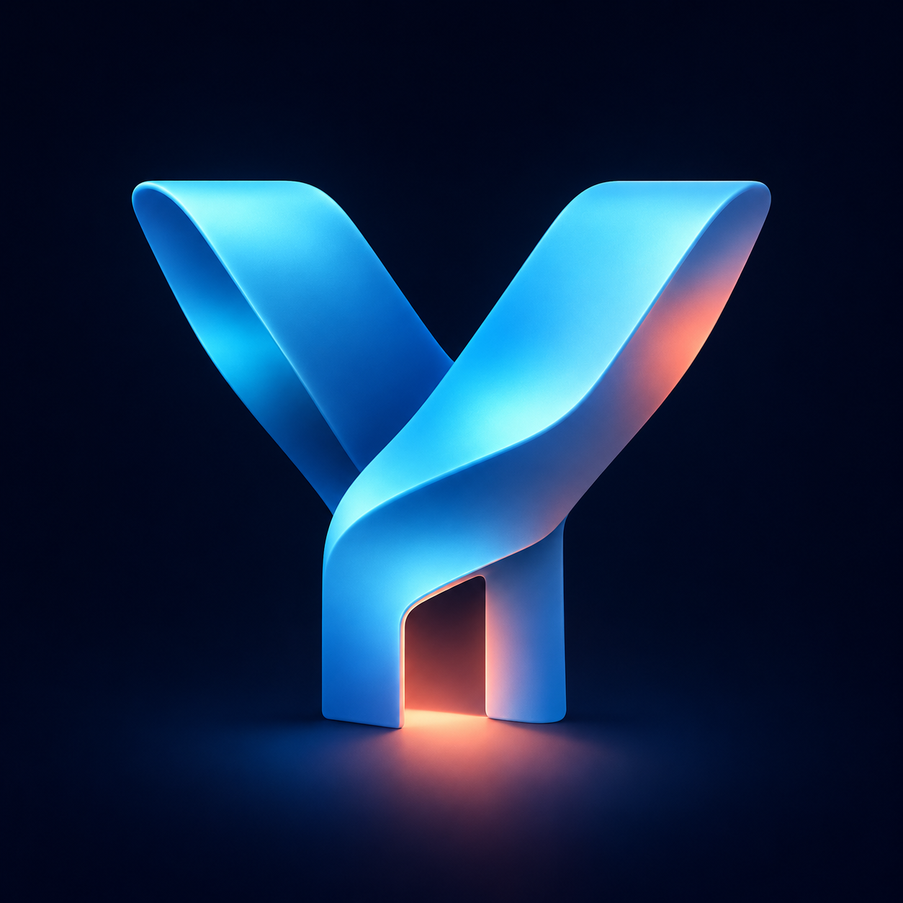

  

<h1 align="center">Yamidashka</h1>

<strong>Красивые и бесплатные программы</strong> Beautiful, useful and free desktop software

Создаю и публикую программы для Windows: удобные инструменты с понятным интерфейсом. Здесь можно скачать готовые сборки, посмотреть исходники и сообщить о проблемах.

I build and share free Windows apps with thoughtful interfaces. Explore the source, download a release, or report an issue in the project repository.

## RTX Video Player

Портативный проигрыватель на базе mpv: генерация кадров VFG или RIFE, RTX Video Super Resolution и HDR. Интерфейс на русском и английском.

Portable mpv-based video player with VFG or RIFE frame interpolation, RTX Video Super Resolution and HDR. Russian and English interface.

**[Скачать / Download](https://github.com/Yamidashka/rtx-video-player/releases/latest)** · [Исходники / Source](https://github.com/Yamidashka/rtx-video-player) · [Сообщить о проблеме / Report an issue](https://github.com/Yamidashka/rtx-video-player/issues)

Для VFG отдельно нужен NVIDIA Maxine SDK с компонентом VFG. В RIFE включены DirectML и модели. Требования и лицензии указаны в репозитории программы.
